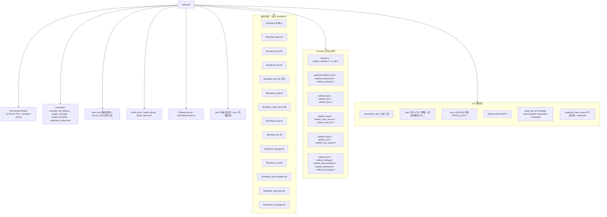

<div align="center">
  
  <h1>NetLeaf</h1>
  <p><b>NetLeaf</b> 是一个现代化的、高性能的跨平台网络库（Windows/Linux/macOS/Android），采用 <b>NL扩展系统</b> 架构。提供 TCP/UDP、HTTP/1.1 + HTTP/2、WebSocket、MQTT v5.0 协议支持，内置全异步 Web 引擎、TLS/SSL 加密、智能路由、多语言等扩展模块。</p>
  
  
  <a href="https://github.com/Mbed-TLS/mbedtls"></a>
  <a href="https://mqttt.com"></a>
  <a href="https://opensource.org/license/BSD-3-Clause"></a>
  <a href="https://en.cppreference.com/c"></a>
</div>

## 特性

- **NL扩展系统** - 动态模块加载、依赖管理、生命周期管理与热重载

- **跨平台** - Windows (x86\_64/i686/arm64), Linux, macOS, Android（核心库，arm64-v8a/armeabi-v7a/x86\_64）

- **多协议** - TCP, UDP, HTTP/1.1, HTTP/2, WebSocket, MQTT v3.1.1/v5.0（HTTP/3 QUIC 为独立可选 `quic` 扩展）

- **全异步 Web 引擎（v3.0.0）** - 数据驱动事件引擎，流式 body 64KB 分块 + chunked 编码，SO_REUSEPORT 多实例，30s 空闲超时扫描（slowloris 防护）

- **sendfile 零拷贝（v3.0.0）** - 大文件静态路由走 Linux `sendfile` / macOS BSD `sendfile` / Windows `TransmitFile`，实测提升 3~6 倍、内存 -97%

- **HTTP/2 完整实现（v3.0.0）** - HPACK 双向动态表 + RFC 7541 Huffman 编解码、流状态机、RST_STREAM/GOAWAY

- **HTTPS/2（v3.0.0）** - `nlh_tls_server_*` TLS 服务端 + ALPN h2 协商，H2 over TLS

- **TLS/SSL 加密** - `netleaf_tls2`（mbedTLS 2.28.10 LTS，TLS 1.0-1.3）与 `netleaf_tls3`（mbedTLS 3.6.x，TLS 1.2/1.3）

- **H1 核心服务端并发可配置** - Linux/macOS worker 池 / Windows 全 IOCP 完成线程（1..64）；UDP Windows 侧 16 槽接收环防突发丢包

- **智能路由 / 多语言 / Vue 集成** - 404 路由建议、国际化错误消息、后端 Vue 组件生成

- **IPC / 链接聚合** - 命名管道/Unix Socket 进程间通信、同端口负载均衡

- **动态编码** - UTF-8/GBK/Big5 等自动协商与转码

## 项目结构



## 构建要求

- CMake 3.20+

- C 编译器：MSVC / Clang / GCC（Windows 推荐 MSYS2/MinGW 或 LLVM-MinGW）

- Linux/macOS: GCC/Clang；Android: NDK r25+（交叉编译，见 [docs/android_build.md](docs/android_build.md)）

- mbedTLS 已内置于 `third-party/mbedtls/`（2.28.10，tls2）与 `third-party/mbedtls3/`（3.6.x，tls3），无需额外安装

## 构建方法

### CMake 选项

| 选项 | 默认值 | 说明 |
| --- | --- | --- |
| `BUILD_MQTT` / `BUILD_MQTT_SERVER` | ON | MQTT 客户端 / 服务端 |
| `BUILD_TLS3` | ON | 构建 `netleaf_tls3`（mbedTLS 3.x，TLS 1.2/1.3） |
| `BUILD_TLS` | OFF | 构建 `netleaf_tls2`（mbedTLS 2.28.10），与 `BUILD_TLS3` 互斥 |
| `BUILD_QUIC` | OFF | QUIC/H3 独立扩展（主库不含 QUIC） |
| `BUILD_LANG` | ON | 多语言错误消息 |
| `BUILD_TESTS` / `BUILD_EXAMPLES` | OFF | 测试 / 示例 |
| `NETLEAF_ENABLE_LTO` | OFF | LTO（仅加 `-flto`/`/GL /LTCG`，不提升优化等级） |

### 标准构建（Windows）

```bash
cmake -B build -G "MinGW Makefiles" ^
    -DCMAKE_C_COMPILER=x86_64-w64-mingw32-clang.exe ^
    -DCMAKE_MAKE_PROGRAM=C:\msys64\mingw64\bin\make.exe ^
    -DBUILD_TESTS=ON
cmake --build build --config Release
ctest --test-dir build --output-on-failure
```

### Linux / macOS

```bash
# Linux（或直接使用一键脚本）
cmake -B build -DCMAKE_BUILD_TYPE=Release -DBUILD_TESTS=ON
cmake --build build --config Release
ctest --test-dir build --output-on-failure

# macOS 一键脚本
chmod +x build_macos.sh && ./build_macos.sh

# Windows 一键脚本
build_all.bat
```

## 使用示例

### 基本 HTTP 服务器

```c
#include "netleaf.h"
#include "optimize/netleaf_http.h"
#include <stdio.h>

/* HTTP 处理器：纯 C 函数指针。
 * 注意：*response 必须为堆分配（malloc/calloc/realloc），
 * 传入字符串字面量 / 静态缓冲会在服务端 free(response) 时崩溃；无响应时置 NULL。 */
static void on_http(const nl_http_request_t* req, nl_http_response_t* resp, void* ud) {
    (void)ud;
    const char* path = nlh_req_path(req);

    if (strcmp(path, "/api/hello") == 0) {
        nlh_resp_status(resp, 200);
        nlh_resp_header(resp, "Content-Type", "application/json");
        nlh_resp_body(resp, "{\"message\": \"Hello, NetLeaf!\"}", 38);
    } else {
        nlh_resp_status(resp, 404);
        nlh_resp_body(resp, "Not Found", 9);
    }
}

int main(void) {
    nl_http_server_t* server = nlh_server_create(8080);
    if (!server) {
        return 1;
    }

    nlh_server_set_handler(server, on_http, NULL);
    nlh_server_start(server);
    printf("Server running on http://0.0.0.0:8080\n");

    nlh_server_stop(server);
    nlh_server_destroy(server);
    return 0;
}
```

> **接口短名转接层（`nlh_*`）**：HTTP/H2 接口提供一一对应的短名转接层
> （`nlh_server_create` / `nlh_req_method` / `nlh_resp_body` …），签名与原长名完全一致、无告警，为推荐用法。
> 原长名（`nl_http_*` / `nl_http2_*`）保留 deprecated 仅作过渡。短名随核心库导出，
> 实现见 `src/http/netleaf_http_shortnames.c`，头文件 `include/optimize/netleaf_http.h`。

### 反向代理 / 混合路由（全异步引擎，Beta）

> 三平台实现：Linux `epoll` / macOS `kqueue` / Windows `IOCP`（无 `FD_SETSIZE` 限制）。
> **混合路由**：同一 server 内 proxy + static + content + redirect + file 可共存。
> `nl_web_start` 检测到 proxy 路由时自动拉起全异步引擎（不分配 worker 池；v3.0.0 支持多实例与 sendfile 零拷贝）。

```c
#include "netleaf.h"

int main(void) {
    nl_web_server_t* server = nl_web_create(8080);
    nl_web_add_proxy(server, "/api/",  "http://127.0.0.1:9000"); // 透明转发 API
    nl_web_add_proxy(server, "/cache/", "tcp://127.0.0.1:6379"); // TCP 透传 Redis
    nl_web_add_html_file(server, "/docs/", "./docs/index.html");  // 文件热加载 + sendfile
    nl_web_start(server);
    // ...
    nl_web_stop(server);
    nl_web_destroy(server);
    return 0;
}
```

### MQTT 客户端

```c
#include "netleaf.h"
#include "netleaf_mqtt.h"
#include <stdio.h>

void on_connect(int rc, void* userdata) {
    printf("MQTT connected with result: %d\n", rc);
}

void on_message(const char* topic, const void* payload, size_t len,
                int qos, int retain, void* userdata) {
    printf("Received [%s] (qos=%d retain=%d): %.20s...\n",
           topic, qos, retain, (const char*)payload);
}

int main(void) {
    nl_mqtt_client_t* client = nl_mqtt_create();

    nl_mqtt_connect_opts_t opts;
    memset(&opts, 0, sizeof(opts));
    opts.client_id     = "netleaf_client_001";
    opts.keep_alive    = 60;
    opts.clean_session = 1;

    nl_mqtt_connect(client, "broker.hivemq.com", 1883, &opts, on_connect);
    nl_mqtt_subscribe(client, "netleaf/#", &(nl_mqtt_sub_opts_t){.qos = 1}, on_message, NULL);

    while (nl_mqtt_get_status(client) == NL_MQTT_CONNECTED) {
        nl_mqtt_maintain(client, 1000);
    }

    nl_mqtt_destroy(client);
    return 0;
}
```

## NL扩展系统

NL扩展系统是 NetLeaf 的运行时动态扩展框架：动态库自动发现（放入 `extensions/` 目录，`nl_modules_init()` 时加载）、依赖声明（`nl_extension_dependency_t`，缺失时注册返回 -2）、生命周期与热重载管理。

```c
#include "netleaf_module.h"

// 扩展定义
NL_EXTENSION_DEFINE(
    my_ext, "My Extension", "1.0.0", "Author",
    "My custom extension", "Windows,Linux,MacOS",
    NL_CAP_THREAD_SAFE,
    my_init, my_shutdown, my_is_available, my_version);

// 使用
nl_extension_init_all();
nl_extension_info_t* info = nl_extension_access("lang");
int count = nl_extension_find_by_capability(NL_CAP_SERVER, servers, 10);
nl_extension_reload_all();
nl_extension_shutdown_all();
```

详见 [wiki/Extension.md](wiki/Extension.md) 与 `examples/plugin_example/`、`examples/plugin_template/`。

## 测试

```bash
ctest --test-dir build --output-on-failure
```

注册测试：`ModulesTest` / `FullTest` / `VariableSubstitutionTest` / `AllModulesTest` / `MqttFramesTest` / `HttpFramesTest` / `MqttServerLoopbackTest` / `WebEngineTest` / `QuicTlsTest`（BUILD_QUIC 时）。压测工具 `test/bench_web.c` 覆盖 CONTENT/FILE/PROXY/慢客户端场景。

## 文档

完整文档见 [wiki/](wiki/Home.md)：快速入门、安装指南、功能特性、API 参考、示例代码、问题排查，以及 TLS、MQTT、Vue、IPC、Lang、LinkAgg、扩展开发等专题页。变更明细见 [CHANGELOG.md](CHANGELOG.md)。

## 更新日志

### v3.0.0（2026-10-31）

- **Web 引擎全异步重构（P1-P12）**：`nl_web_engine_t` 事件引擎 + 流式 body/chunked + 多实例 + 30s 空闲扫描；P8 压测（PROXY 超 legacy 池、10MB 文件 RSS -97%）；P10 sendfile/TransmitFile 零拷贝（3.3~5.9x）；P11 macOS/Windows 对齐；P12 测试体系（9 用例，ASan/TSan 全过）
- **HTTP/2 补完**：HPACK 双动态表 + RFC 7541 Huffman、流状态机、RST_STREAM/GOAWAY（47 断言）
- **HTTPS/2**：`nlh_tls_server_*` TLS 服务端 + ALPN h2 分流
- **Windows 全 IOCP 化**：`nl_server_*` worker 池退役，AcceptEx 预 post + 完成线程；UDP 16 槽接收环
- **QUIC/H3 拆出**独立 `quic` 扩展（`BUILD_QUIC` 默认 OFF）

> v2.4.2 及更早版本的变更见 [CHANGELOG.md](CHANGELOG.md)。

## 版本历史

| 版本 | 日期 | 更新内容 |
| --- | --- | --- |
| 3.0.0 | 2026-10-31 | Web 引擎全异步重构（sendfile 零拷贝、多实例、测试体系）；HTTP/2 补完；HTTPS/2；Windows 全 IOCP 化 + UDP 16 槽接收环；QUIC 拆出独立扩展 |
| 2.4.2 | 2026-09-30 | HTTPS/TLS 重构（`netleaf_https` 独立、tls2/tls3 拆分）；MQTT 默认开启；`nl_util` 公共工具层；H2/QUIC 帧补全；Android 构建支持 |
| 2.4.1 | 2026-09-24 | Lang 错误码接入多语言、动态/外部变量；清理编译告警；全平台交叉编译 |
| 2.4.0 | 2026-09-19 | MQTT v5.0 完整协议、TLS/SSL 集成（mbedTLS）、NL扩展系统 API 增强 |
| 2.2.2 | 2026-09-09 | 扩展库系统、文件热加载、HTTP 重定向、运行时路由管理 |
| 2.2.1 | 2026-09-01 | IPC 通讯、同端口链路聚合、多语言错误消息 |
| 2.2.0 | 2026-08-25 | macOS 平台支持；Auto-complete / Auto-route / ErrorPage 模块 |
| 2.1.0 | 2026-08-20 | 路由修正、动态编码、懒加载 |
| 2.0.0 | 2026-08-15 | 重构为模块化架构 |

## 许可证

BSD 3-Clause License - 详见 [LICENSE](LICENSE) 文件

## 开源项目来源

| 项目 | 用途 | 许可证 | 仓库链接 |
| --- | --- | --- | --- |
| **mbedTLS** | TLS/SSL 加密库 | Apache 2.0 / GPL v2.0 | [Mbed-TLS/mbedTLS](https://github.com/Mbed-TLS/mbedTLS) |
| **MQTT Specification** | MQTT v5.0 协议规范 | EPL-2.0 / EDL 1.0 | [mqtt.org](https://mqtt.org/) |
| **Paho MQTT C** | MQTT C 客户端参考实现 | EPL-2.0 / EDL 1.0 | [eclipse/paho.mqtt.c](https://github.com/eclipse/paho.mqtt.c) |

### mbedTLS 集成说明

本项目内置 mbedTLS 源码：`third-party/mbedtls/`（2.28.10 LTS，供 `netleaf_tls2`）与 `third-party/mbedtls3/`（3.6.x，供 `netleaf_tls3`）。

> ⚠️ **安全提示（不推荐 TLS 1.0 / 1.1）**
> TLS 1.0 与 TLS 1.1 已被 [RFC 8996](https://www.rfc-editor.org/rfc/rfc8996) 正式废弃，存在已知弱点，**不建议在新项目或生产环境中使用**。
> 请把 `nl_tls2_config_t` 的 `min_proto` 设为 `NL_TLS2_PROTO_TLS1_2`（或更高）。

详细 API 见 `include/netleaf_tls2.h` / `include/netleaf_tls3.h` 与 [wiki/TLS.md](wiki/TLS.md)。

欢迎提交 Issue 和 Pull Request！

***
